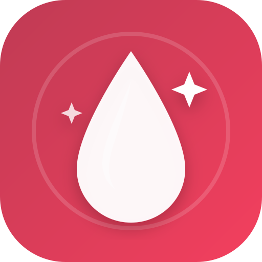

# CapilarFlow 🌿💆‍♀️
> Aplicativo de Cronograma Capilar & Scalp Care personalizado para Cabelo 2C/3A Fio Fino & Dermatite Seborreica.



## ✨ Sobre o Projeto
O **CapilarFlow** foi desenvolvido sob medida para rotinas capilares com necessidades específicas:
- **Curvatura 2C / 3A (Ondulado a Cacho Aberto)** com **Fio Fino** (sensível a peso e acúmulo de resíduos).
- **Baixa Porosidade** (cutículas fechadas, necessitando de hidratações aquosas e fluidas, com restrição a excesso de queratina).
- **Couro Cabeludo com Dermatite Seborreica** (protocolo de aplicação apenas na raiz, proteção de pontas com Pré-Poo e controle de dias).

---

## 🚀 Funcionalidades
1. **Cronograma Dinâmico de 4 Semanas:**
   - Visualização clara das 12 etapas principais do ciclo.
   - Cálculo automático do próximo passo e status de conclusão.
2. **Protocolo para Dermatite Seborreica:**
   - Alertas e regras de ouro (pré-poo protetor, nunca dormir com cabelo molhado).
   - **Timer integrado de 3 minutos** com alarme para o tempo de ação do shampoo anticaspa no banho.
   - Contador de dias desde o último uso de shampoo medicamentoso.
3. **Calibrador de Porosidade:**
   - Guia interativo do Teste do Copo d'Água (Boiou, Ficou no Meio, Afundou).
   - Recalibra o cronograma com apenas 1 clique.
4. **Analisador de Rótulos de Produtos:**
   - Cole a composição de qualquer produto para identificar automaticamente a etapa (H, N ou R) e receber um veredito se o produto é seguro ou se pesa no fio fino.
5. **Vitrine & Meu Armário:**
   - Lista com produtos recomendados prontos para adicionar com 1 clique.
   - Gestão de produtos cadastrados por categoria (Pré-poo, Dermatite, H, N, R, Acidificante, Finalizador).
6. **Histórico Completo:**
   - Registro de lavagens, notas e sensação pós-secagem salvos automaticamente no navegador (`localStorage`).
7. **PWA & Offline:**
   - Funciona no computador e pode ser instalado como app no Android através do Chrome.

---

## 🛠️ Como Executar

### No Computador
Basta dar dois cliques no arquivo:
```cmd
abrir-app.bat
```
Ou abrir o arquivo `index.html` em qualquer navegador.

### No Celular (Rede Local)
1. Dê dois cliques no arquivo `abrir-no-celular.bat`.
2. Abra o endereço exibido no navegador do seu smartphone Android.
3. Toque em **"Instalar App"** para adicionar à tela inicial.

---

## 👤 Autor
- **GitHub:** [@capellarienrico](https://github.com/capellarienrico)
